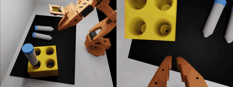

# SO-101 × Isaac Sim × GR00T N1.6 仿真环境复现



**[播放完整双相机仿真录像（MP4，24.9 秒）](media/so101-groot-n16-4090.mp4)** · [原始评测 JSON](evidence/result.json) · [视频帧数与动作核对](evidence/result-summary.json)

2026-11-01 在 AutoDL RTX 4090 上，以原生 Python 环境运行 Isaac Sim 5.1 + SO-101 场景，经本机 ZeroMQ 调用独立 Python 3.10 环境的 GR00T N1.6 SO-101 微调权重。教程评测任务 3/3 回合达到场景的成功条件（250、255、243 步），合计 748 步、46 次模型请求。双视角视频 1280×480、30 fps、748 帧；请求延迟中位数 187.7 ms。**这验证了仿真推理链路；未做真机、训练或 Pi0.5 验证，也不能由三次试验推断长期成功率。**

> 仓库名称保留 Pi05 以备后续扩展；当前实际运行的 backbone 为 **GR00T N1.6**。此项目基于 [NVIDIA SO-101 Sim-to-Real Workshop](https://github.com/isaac-sim/Sim-to-Real-SO-101-Workshop) 的 Apache-2.0 代码与任务；原版说明在 [docs/UPSTREAM_README.md](docs/UPSTREAM_README.md)，许可证在根目录，第三方声明见 [docs/THIRD_PARTY_NOTICES](docs/THIRD_PARTY_NOTICES)。

## 运行环境

| 项目 | 已测试配置 |
| --- | --- |
| GPU / 驱动 | NVIDIA RTX 4090，24564 MiB；580.76.05 |
| 系统 | Ubuntu 22.04.5 x86_64；glibc 2.35；CUDA Toolkit 12.8.93 |
| Isaac Sim | 5.1.0.0；Python 3.11.18；torch 2.7.0+cu128 |
| SO-101 仿真 | 独立 `so101-sim` venv，继承 Isaac Sim；lxml 6.1.3；NumPy 1.26.0 |
| GR00T 推理 | 独立 `groot-n16` Python 3.10.12；torch 2.7.1+cu128；flash-attn 2.7.4.post1 |
| 连接方式 | localhost ZeroMQ `127.0.0.1:5555`，外部视角 → front、腕部视角 → wrist |

详细环境版本、第一次安装过程、下载命令、OBS 恢复方式和依赖边界：[**4090 部署及复现指南**](docs/DEPLOYMENT_4090.md)。

## 最短复现路径：恢复已验证环境

使用 **Ubuntu 22.04 x86_64、可用的 NVIDIA RTX/Vulkan 设备**，先按 [引擎恢复手册](docs/ENGINE_OBS_RESTORE.md) 恢复 Isaac Sim 基础环境，再按 [4090 部署指南的 Workshop 叠加层步骤](docs/DEPLOYMENT_4090.md#2-恢复-gr00t--so-101-叠加层) 恢复单独的仿真、推理环境、完整 USD 资产和 GR00T 权重。需要持有者自行配置对 OBS 桶的读取权限；不在仓库发布密钥、18 GB 引擎快照或约 9.8 GB 模型。

恢复到原绝对路径后，在 AutoDL Linux 终端执行：

```bash
# 1. 检查仿真场景、物理和两路相机；结果写入 workshop/results/smoke/
bash /root/autodl-tmp/isaac-transfer-tools/workshop/16_sim_scene.sh

# 2. 终端 A：启动独立的 GR00T N1.6 模型服务器，等日志出现 ready
bash /root/autodl-tmp/isaac-transfer-tools/workshop/17_groot_server.sh

# 3. 终端 B：执行三回合仿真闭环；结果和录像写入 workshop/results/inference/
bash /root/autodl-tmp/isaac-transfer-tools/workshop/18_so101_eval.sh
```

`17_groot_server.sh` 把输出写到 `/root/autodl-tmp/workshop/logs/17_groot_server.log`；看到 `Server is ready and listening` 后再运行评测。验收时应检查 `result.json` 的回合结果和 `front-wrist.mp4`，不要仅看 Isaac Sim 进程返回码。上述脚本副本位于 [deploy/native/workshop](deploy/native/workshop)；实际运行的是已测试的原绝对路径版本。

## 从零安装与来源

如果无法访问 OBS，可以按 [完整部署指南](docs/DEPLOYMENT_4090.md) 的原生安装步骤准备系统库、Isaac Sim、固定版本的 IsaacLab / LeRobot / GR00T、实物 USD 资产、微调检查点，再分别安装仿真与推理依赖。安装脚本及下载器放在 `deploy/native/engine` 和 `deploy/native/workshop`。这条路径记录了此次安装时的有效命令及处理过的依赖问题；跨设备应重新跑引擎/物理/相机及策略测试。

| 内容 | 固定版本或来源 |
| --- | --- |
| IsaacLab | v2.3.2 |
| Isaac-GR00T | `ead52833afbbf4243f8cd5e7664f48a94de03b19` |
| LeRobot | `e670ac5daf9b76` |
| 任务模型 | `aravindhs-NV/grootn16-finetune_sreetz-so101_teleop_vials_rack_left` / `checkpoint-10000`，revision `7efab50dfd58cd8f1831035fd86b65410b98c448` |

原始 `source/` 下的 USD、EXR 和纹理在此仓库保留**上游 Git LFS 指针文本**；使用 [fetch_assets.py](deploy/native/workshop/fetch_assets.py) 向上游下载并按 SHA256 验证 37 个真实资产，或者使用 OBS 叠加层。仅克隆仓库不能直接启动完整场景。公开的训练数据集没有作为本次预训练权重评测的前提，也不随本仓库分发。

## 目录

- `source/sim_to_real_so101/`：上游 SO-101 场景、相机和策略客户端代码。
- `deploy/native/engine/`：4090 上实际使用的系统依赖、Isaac Sim 安装、物理和相机测试脚本。
- `deploy/native/workshop/`：权重、资产、环境安装记录及本次闭环评测脚本。
- `docs/DEPLOYMENT_4090.md`：完整操作顺序、命令、路径和故障边界。
- `evidence/` 与 `media/`：不含机器凭据的运行摘要、结果及录像。

## 已知范围

本次测试通过 Isaac Sim 物理接触和双相机、SO-101 场景以及 GR00T N1.6 闭环；仿真依赖保留 LeRobot/NumPy/Starlette 的元数据告警，推理环境没有安装 DeepSpeed 训练和 TensorRT 导出后端。PRO6000 / Blackwell 的恢复、真机控制和 Pi0.5 微调均未验收。具体告警及验收依据见部署指南。
