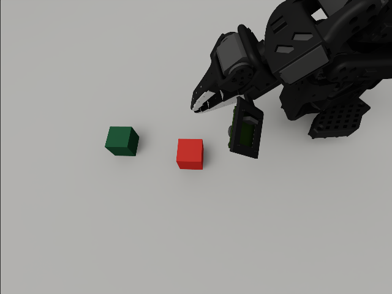
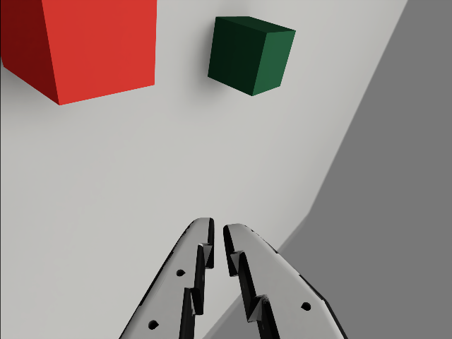
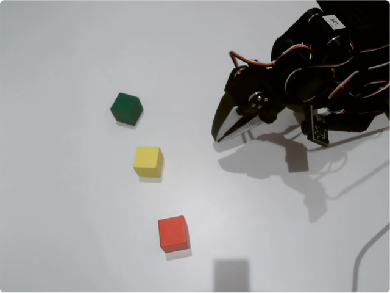
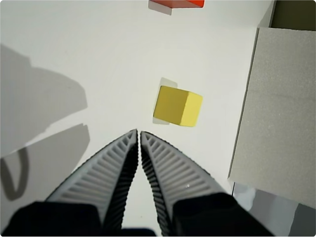
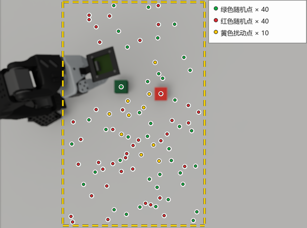

# IsaacSim x Pi0.5 x SO101 Sim-to-Real Project


本项目迁移了原 [NVIDIA SO-101 Sim-to-Real Workshop](https://github.com/isaac-sim/Sim-to-Real-SO-101-Workshop) 的代码，在 AutoDL 租用 RTX 4090 云主机跑通 IsaacSim 5.1 与 GR00T N1.6 的原始试管入架任务后，自行构建了面向真机视觉对齐的方块抓取与叠放任务。采用俯视与腕部双摄像头，分辨率 640×480，帧数 30 fps，动作按 30Hz 随相机帧一同记录。分离式请求框架延迟中位数 187.7 ms。


## 运行环境

| 项目 | 已测试配置 |
| --- | --- |
| GPU / 驱动 | NVIDIA RTX 4090，24564 MiB；580.76.05 |
| 系统 | Ubuntu 22.04.5 x86_64；glibc 2.35；CUDA Toolkit 12.8.93 |
| Isaac Sim | 5.1.0.0；Python 3.11.18；torch 2.7.0+cu128 |
| SO-101 仿真 | 独立 `so101-sim` venv，继承 Isaac Sim；lxml 6.1.3；NumPy 1.26.0 |
| GR00T 推理 | 独立 `groot-n16` Python 3.10.12；torch 2.7.1+cu128；flash-attn 2.7.4.post1 |
| 连接方式 | localhost ZeroMQ `127.0.0.1:5555`，外部视角 → front、腕部视角 → wrist |

详细环境版本、第一次安装过程、下载命令、OBS 恢复方式和依赖边界：[**4090 部署及复现指南**](docs/DEPLOYMENT_4090.md)。

远程看图与本地主臂遥操作的当前实测范围、接入接口和待解决的端口限制：[**4090 实时画面与主臂接入核查**](docs/REMOTE_TELEOP_4090.md)。

本地主臂接上后逐步启动仿真画面、遥操作和 LeRobot episode 录制：[**SO-101 主臂遥操作快速上手**](docs/SO101_REMOTE_TELEOP_QUICKSTART.md)。本地使用 [BlossomsGarden/pick-and-place-v3_20261025_051506](https://huggingface.co/datasets/BlossomsGarden/pick-and-place-v3_20261025_051506/tree/main) 下 `lelab-portable-win64.zip` 自带的虚拟环境；解压到相邻的 `lelab-main` 后，启动脚本实际调用 `../lelab-main/.venv/Scripts/python.exe`，复用其中的 LeRobot、串口库和主臂标定。此前录制的遥操作画面仅展示主臂与仿真画面，并非真机从臂执行结果。

### 白桌抓方块场景（2026-11-15）

| Sim Cam.top | Sim Cam.wrist | Real Cam.top | Real Cam.wrist |
| :---: | :---: | :---: | :---: |
|  |  |  |  |

四张图片均为 640×480，表格中按相同比例展示。真机两张图从 `assets/real-demo.png` 裁出，数据集原始相机键依次为 `observation.images.side` 和 `observation.images.front`；表头的 top / wrist 表示对照用途，未声称相机外参或物体布置完全一致。

外部 side 相机高度降至 0.30 m，并略微放宽视野以呈现更多机身侧面；仍关闭景深模糊以提升清晰度；腕部 RGB 观测独立增亮，不改场景照明及原始英伟达任务。

参考本地 `isaaclab-pick-and-place` 数据集首帧的方块相对布局，新增独立场景：扩至 1.21 × 1.00 m 的浅灰白桌板、黑色 SO-101 与两片白色侧面、黑色内外缘的夹指、按真机样本调色的左侧绿色方块和右侧红色方块，以远光留下柔和阴影，没有灯箱围墙。外部相机参考真机 `pick-and-place-v3_20261025_051506` 的 side 视角；保持基座、相机与夹爪开合量，单独把旋转关节从 -0.0456 调到 0.4000 rad，使两片夹指在 side 画面中朝向绿方块；内外黑边只修改 USD 视觉面集，夹指根部和腕部连接件仍保持黑色。此调整用于图像构图，并非已经标定好的三维抓取姿态。4090 上完成 40 步物理与双相机 640×480 截图检查；**尚未用真主臂采集方块回合**。环境 ID、运行方式及结果路径见[白桌抓方块场景说明](docs/CUBES_WHITE_TABLE_4090.md)。

#### 方块初始位置采样预览



图中标出 40 个绿色候选点、40 个红色候选点和 10 个扰动点，是位置采样的预览。**当前仓库的 `cubes_white_table_env_cfg.py` 仍使用固定初始坐标，尚未将这些随机位置接入场景重置或录制流程**；正式生成随机化训练数据前需要实现并验证重置采样。

### 遥操作录制状态（2026-11-08）

本次真主臂已驱动仿真动作；正式数据集 /root/autodl-tmp/workshop/datasets/so101-remote-vials/ 经核查为 **0 回合、0 帧**，已清除其中只含空元数据及空图片目录的中间文件。一次 16 帧的短录制已按指令丢弃；之后点击“保存本回合”时并未处于录制状态，旧页面却仍返回“已提交”。日志确定“重置场景”进入 env.reset() 后进程退出，启动至退出约五分钟，排除 30 分钟启动超时；底层退出原因尚未定位。

已按相邻 LeLab 的逐回合 save_episode()、保存完 finalize() 的流程修复录制：远端安装的 LeRobot 0.4.3 **不提供** resume()，因此使用适配其实际接口的已完成数据集续写逻辑。隔离目录已实测两次双相机 episode 保存、重开并确认 2 回合／4 帧，测试目录随后自动删除；**未重启 Isaac Sim，真臂场景中的保存仍待下次实际录制验收。** 页面现在会等待命令执行结果；无录制时保存／丢弃返回 409。“重置场景”暂时返回明确的 409，以避免再次把服务关闭；需要实际重置场景时，须先排查 Isaac Sim 的 env.reset() 退出问题。操作步骤及代码验证方式见[遥操作指南](docs/SO101_REMOTE_TELEOP_QUICKSTART.md)。

## 最短复现路径：恢复已验证环境

使用 **Ubuntu 22.04 x86_64、可用的 NVIDIA RTX/Vulkan 设备**，先按 [引擎恢复手册](docs/ENGINE_OBS_RESTORE.md) 恢复 Isaac Sim 基础环境，再按 [4090 部署指南的 Workshop 叠加层步骤](docs/DEPLOYMENT_4090.md#2-恢复-gr00t--so-101-叠加层) 恢复单独的仿真、推理环境、完整 USD 资产和 GR00T 权重。需要持有者自行配置对 OBS 桶的读取权限；不在仓库发布密钥、18 GB 引擎快照或约 9.8 GB 模型。

恢复到原绝对路径后，在 AutoDL Linux 终端执行：

```bash
# 1. 检查仿真场景、物理和两路相机；结果写入 workshop/results/smoke/
bash /root/autodl-tmp/isaac-transfer-tools/workshop/16_sim_scene.sh

# 2. 终端 A：启动独立的 GR00T N1.6 模型服务器，等日志出现 ready
bash /root/autodl-tmp/isaac-transfer-tools/workshop/17_groot_server.sh

# 3. 终端 B：执行三回合仿真闭环；结果和录像写入 workshop/results/inference/
bash /root/autodl-tmp/isaac-transfer-tools/workshop/18_so101_eval.sh
```

`17_groot_server.sh` 把输出写到 `/root/autodl-tmp/workshop/logs/17_groot_server.log`；看到 `Server is ready and listening` 后再运行评测。验收时应检查 `result.json` 的回合结果和 `front-wrist.mp4`，不要仅看 Isaac Sim 进程返回码。上述脚本副本位于 [deploy/native/workshop](deploy/native/workshop)；实际运行的是已测试的原绝对路径版本。

## 从零安装与来源

如果无法访问 OBS，可以按 [完整部署指南](docs/DEPLOYMENT_4090.md) 的原生安装步骤准备系统库、Isaac Sim、固定版本的 IsaacLab / LeRobot / GR00T、实物 USD 资产、微调检查点，再分别安装仿真与推理依赖。安装脚本及下载器放在 `deploy/native/engine` 和 `deploy/native/workshop`。这条路径记录了此次安装时的有效命令及处理过的依赖问题；跨设备应重新跑引擎/物理/相机及策略测试。

| 内容 | 固定版本或来源 |
| --- | --- |
| IsaacLab | v2.3.2 |
| Isaac-GR00T | `ead52833afbbf4243f8cd5e7664f48a94de03b19` |
| LeRobot | `e670ac5daf9b76` |
| 任务模型 | `aravindhs-NV/grootn16-finetune_sreetz-so101_teleop_vials_rack_left` / `checkpoint-10000`，revision `7efab50dfd58cd8f1831035fd86b65410b98c448` |

原始 `source/` 下的 USD、EXR 和纹理在此仓库保留**上游 Git LFS 指针文本**；使用 [fetch_assets.py](deploy/native/workshop/fetch_assets.py) 向上游下载并按 SHA256 验证 37 个真实资产，或者使用 OBS 叠加层。仅克隆仓库不能直接启动完整场景。公开的训练数据集没有作为本次预训练权重评测的前提，也不随本仓库分发。

## 目录

- `source/sim_to_real_so101/`：上游 SO-101 场景、相机和策略客户端代码。
- `deploy/native/engine/`：4090 上实际使用的系统依赖、Isaac Sim 安装、物理和相机测试脚本。
- `deploy/native/workshop/`：权重、资产、环境安装记录及本次闭环评测脚本。
- `docs/DEPLOYMENT_4090.md`：完整操作顺序、命令、路径和故障边界。
- `assets/`：白桌场景、初始位置采样图、主臂遥操作与 GR00T 仿真演示。

## 已知范围

本次测试通过 Isaac Sim 物理接触和双相机、SO-101 场景以及 GR00T N1.6 闭环；仿真依赖保留 LeRobot/NumPy/Starlette 的元数据告警，推理环境没有安装 DeepSpeed 训练和 TensorRT 导出后端。PRO6000 / Blackwell 的恢复、真机控制和 Pi0.5 微调均未验收。具体告警及验收依据见部署指南。
