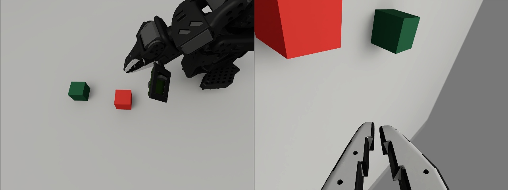

# SO-101 白桌抓方块场景（AutoDL 4090）



场景以本地 `so101/datasets/BlossomsGarden--isaaclab-pick-and-place` 的首帧作为方块相对布局参考：绿色方块在左，红色方块在右。机械臂起始关节参考真机 `pick-and-place-v3_20261025_051506` 前 30 条 episode；外部相机参考该数据集 side 视角，从画面右上方看到黑色机械臂伸入、两片白色侧面、黑色内外缘的夹指在画面中朝向绿色方块。此处属于图像对齐试配，未做相机外参标定或轨迹复用。

## 场景内容

- 直接复用 Workshop 的 SO-101 USD 机械臂与腕部相机；外部 side 相机从 (0.31, -0.11, 0.41) m 降至 (0.31, -0.06, 0.30) m，姿态改为 `side_camera_quat(25, 14.5, -12.3)`、焦距从 13.1 mm 略放宽至 11.0 mm，让机身侧面更多进入画面。对焦距离仍为 0.68 m、f-stop 0；两路 RGB 均为 640×480。`top.png` 与 `rgb_external_D455` 沿用旧文件名和观测键，实际是外部 side 视角。
- 用 **1.21 × 1.00 × 0.025 m** 浅灰白碰撞桌板代替黑色垫子；中心 (0.205, 0.10, -0.0125) m，范围 x∈[-0.40, 0.81] m、y∈[-0.40, 0.60] m。桌面高度仍为 0 m，方块和机械臂在桌上的物理高度不变。扩大左侧和上方后，外部相机画面四边均被桌面覆盖；桌下中灰背景平面保持不变，没有围墙。
- 本方块任务基座保持 `(0.450, 0.148, 0) m`、偏航角 `-55°`；关节目标为 `[0.4000, -1.7453, 1.4535, 0.9450, 0.0405, -0.1705] rad`（底座旋转、肩、肘、腕俯仰、腕滚转、夹爪）。底座旋转关节相对真机第 15 帧中位数 -0.0456 rad 增加 0.4456 rad，使夹指在 side 画面中顺时针朝向绿方块；腕俯仰为对齐像素位置比中位数增加 0.0435 rad，其余关节仍取真机前 30 条 episode 第 15 帧的中位数；**夹爪开合值 -0.1705 rad 未调整**。肩关节原始读数约 -103.4，超出映射定义的 -100° 下限，在仿真中限于 -100°。此处只做图像朝向试配；三维抓取位姿和相机外参仍需标定，不能直接用截图推断夹爪在三维空间已经对准方块。
- 使用两个独立的可碰撞、可抓取的 **35 mm** 立方体，分别为绿色与红色；机械臂机身与夹指根部为黑色，两片夹指的侧面为白色，朝向与远离指间间隙的窄边为黑色。USD 材质 `SO-ARM101-BLACK-WHITE.usda` 的白色漫反射值 0.78/0.78/0.77 分别绑定到固定夹指的 6,325/28,796 个网格面、活动夹指的 4,384/28,270 个网格面；电机座和腕部连接件仍是黑色；该包覆外观只修改视觉材质，没有添加或修改碰撞几何。绿色立方体六面共用同一固定漫反射材质，依据真机视频顶部 RGB (27, 74, 47) 校准；当前姿态下仿真固定采样点测得 RGB (31, 81, 53)，材质值未调整，不同面仍会因光照而有明暗差别。桌板的材质漫反射为 (0.55, 0.55, 0.54)，预览中的桌面样本为 RGB (176, 175, 173)。环境光和方向主光保持原参数，保留柔和阴影。
- 真机数据集前 5 条 episode 的两路图像对比：腕部（front）相机在相近桌面区域比外部（side）相机亮约 15–21 灰度值。腕部 RGB 观测输出仍使用 1.11 倍数字增益，环境光、灯光颜色和腕部相机参数未修改；该增益会进入实时预览和保存的腕部视频。
- Gym 任务 ID：`Lerobot-So101-Teleop-Cubes-White-Table`；原试管任务保持独立。为兼容现有遥操作录制脚本，外部 side 图使用旧键 `obs["visual"]["rgb_external_D455"]`；它在本任务中不是真实 D455。腕部图使用 `obs["visual"]["rgb_ego"]`。

## 4090 复现

在已恢复并装有全部真实 USD 资产、Isaac Sim 5.1 和 `so101-sim` 环境的 AutoDL 4090 上，先将仓库的 `source/sim_to_real_so101/tasks/` 和 `source/sim_to_real_so101/assets/usd/SO-ARM101-BLACK-WHITE.usda` 同步到服务器原仓库，再将 `deploy/native/workshop/cubes_white_table_smoke.py`、`run_cubes_white_table_smoke.sh` 同步到 `/root/autodl-tmp/isaac-transfer-tools/workshop/`。若上游 USD 网格发生变化，可在同一环境运行 `build_so101_finger_material.py --asset-dir <assets/usd> --headless --kit_args=--allow-root` 重新生成两组夹指面集。当前租用的机器已同步。

```bash
bash /root/autodl-tmp/isaac-transfer-tools/workshop/run_cubes_white_table_smoke.sh
cat /root/autodl-tmp/workshop/results/cubes-white-table/result.json
```

它运行 40 步固定姿态的物理和视觉检查，无需 GR00T 或真实主臂；在 `/root/autodl-tmp/workshop/results/cubes-white-table/` 保存 `top.png`（外部 side 画面）、`wrist.png`、`top-and-wrist.png` 和 `result.json`。脚本验证新基座与关节目标、方块留在桌面、机身和夹爪颜色，并确认双相机均为 640×480，外部画面左侧与上方不再出现桌缘，四边裸露桌面区域的颜色保持一致。方块任务遥操作服务启动时以相同关节目标保持初始姿态。

后续若要用**真主臂**进行这个方块任务的遥操作与录制，先确保原来的 8765 端口服务已停止，在服务器启动该任务并使用新的数据集目录；本地再运行已有的 SSH 隧道和主臂客户端：

```bash
bash /root/autodl-tmp/isaac-transfer-tools/workshop/run_so101_remote_teleop.sh \
  --task Lerobot-So101-Teleop-Cubes-White-Table \
  --task-name "Pick up the green cube and place it next to the red cube" \
  --dataset-root /root/autodl-tmp/workshop/datasets/so101-cubes-white-table \
  --repo-id local/so101-cubes-white-table \
  --fps 30
```


方块场景只接受 --fps 30，双相机尺寸均固定为 640×480；每帧对应 4 个 120 Hz 物理子步。本地主臂录制时先启动上述 4090 命令，再用 Start-SO101-Teleop.ps1 -Fps 30 连接已运行的方块服务。独立的 LeRobot 存储测试完成了一条 6 帧 episode：两路 MP4 均为 640×480、30/1 fps；测试数据已删除。正式保存后仍须核查数据集 meta/info.json 的 fps 和视频分辨率。

注意：4090 上双 640×480 RGB 相机的遥操作循环实测约 16.33 帧/秒（无主臂、无录制编码）。保存的视频虽然标记为仿真时钟 30 fps，但当前机器无法保证真实墙上时间每秒采集 30 帧；需要更快的机器再实测实时 30 fps。最终场景的 40 步冒烟测试通过，截图见本页预览；原始检查结果保存在运行机器的 `/root/autodl-tmp/workshop/results/cubes-white-table/result.json`。

本机原有 `Start-SO101-Teleop.ps1` 会复用已启动的服务。**方块场景已做仿真 smoke，真实主臂录制在此新场景尚未验收**；不要把测试图片或旧试管回合混入新数据集。
